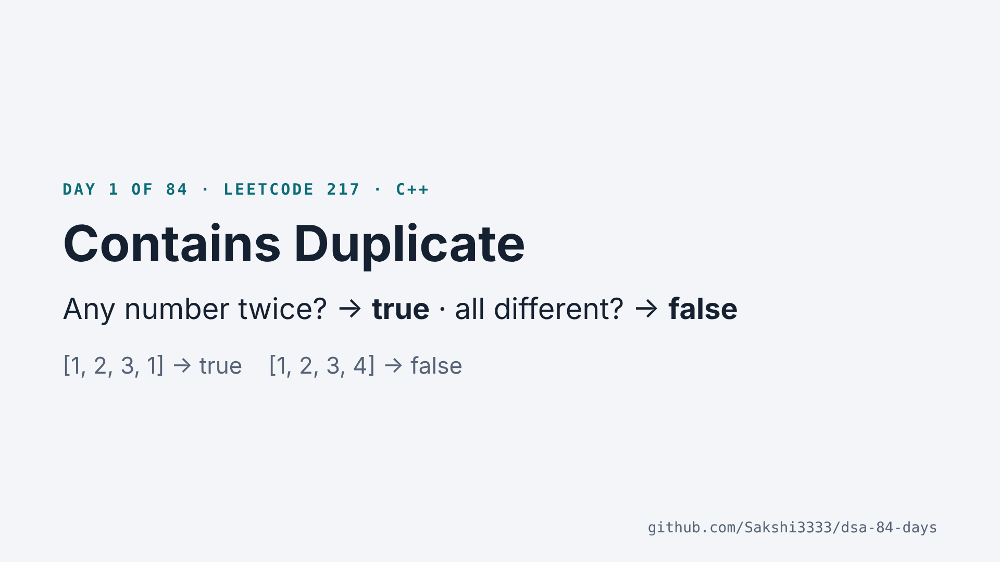
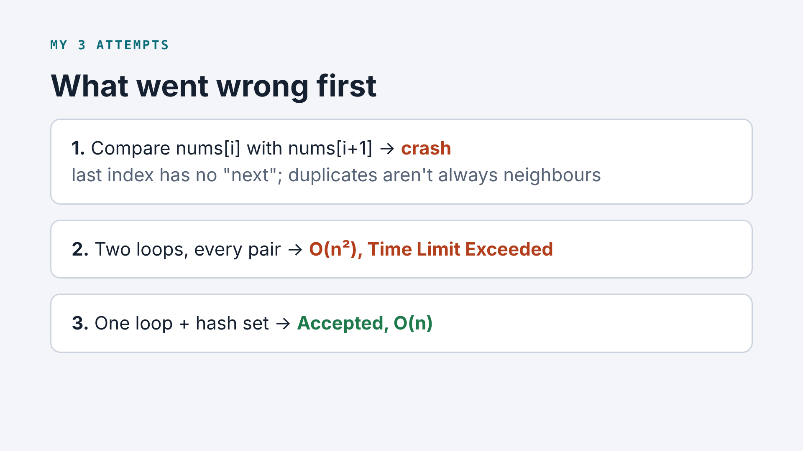
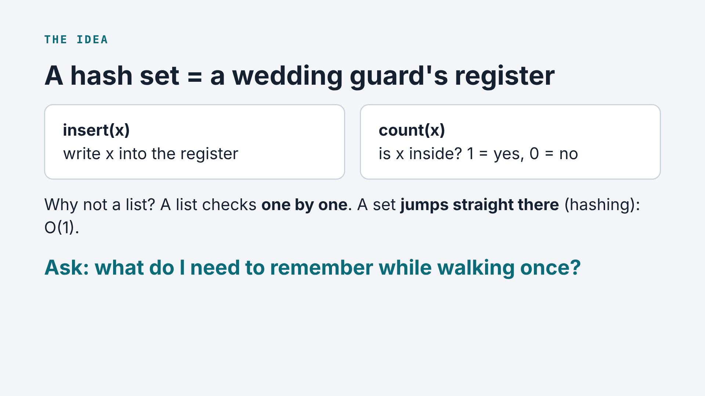
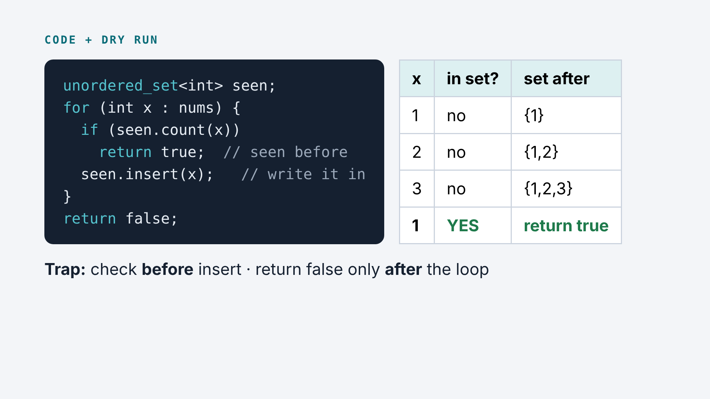
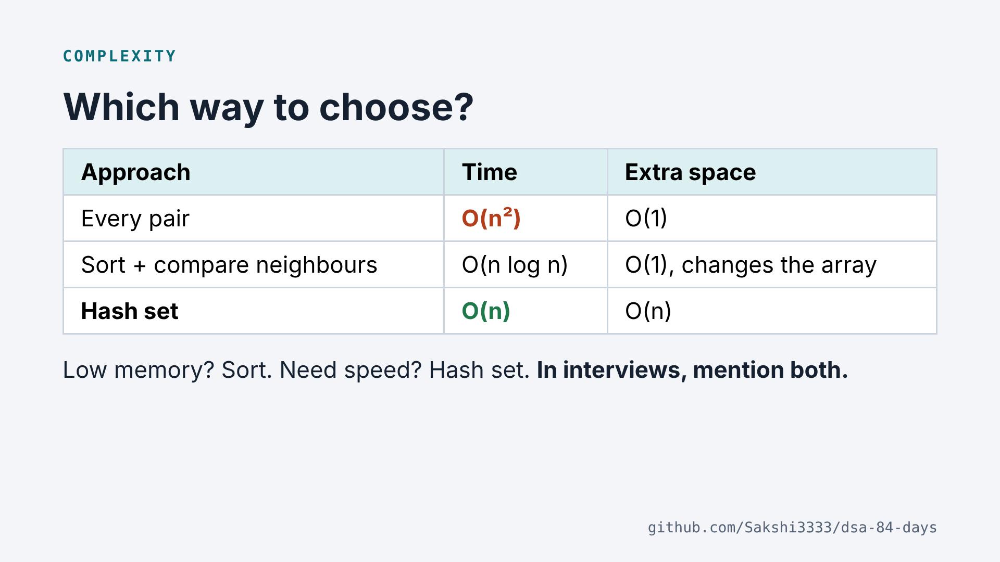

# Contains Duplicate

[LeetCode 217](https://leetcode.com/problems/contains-duplicate/) · Easy · Pattern: **hash set** · Solved 25 Oct 2026

Return `true` if any number appears at least twice in the array, otherwise `false`.
`[1,2,3,1]` → `true` · `[1,2,3,4]` → `false`

## My journey

| Attempt | What I tried | Result | Lesson |
|---|---|---|---|
| 1 | Compared `nums[i]` with `nums[i+1]` | Crash: `heap-buffer-overflow` | At the last index, `i+1` is outside the array. And duplicates are not always next to each other. |
| 2 | Two loops comparing every pair | First wrong (I compared `i == j`, the positions), then Time Limit Exceeded | Compare `nums[i] == nums[j]`. O(n²) is too slow for 100,000 numbers. |
| 3 | One loop + `unordered_set` | **Accepted** | Ask: "what do I need to remember while I walk the array once?" |

## The idea as a story

A **wedding guard with a guest register**. Each number "arrives". If its name is already in the register, it's a duplicate. If not, the guard writes it in.

- `seen.insert(x)` writes x into the register
- `seen.count(x)` asks "is x in the register?" (1 = yes, 0 = no)

**Why a set and not a list?** A list checks items one by one (O(n) per check). A set uses hashing and jumps straight to the right place (O(1) on average).

## Complexity

| Approach | Time | Extra space |
|---|---|---|
| Every pair | O(n²) | O(1) |
| Sort, then compare neighbours | O(n log n) | O(1)*, but changes the input |
| **Hash set** | **O(n)** | O(n) |

*apart from what the sort itself uses

## Trap

Check **before** inserting (otherwise every number finds itself), and return `false` only **after** the loop.

## Interview follow-up

**Q:** 10 crore numbers and very little memory?
**A:** Sort and compare neighbours. Almost no extra memory, but it costs time (O(n log n) instead of O(n)) and changes the original array. If I can't change it, I need a copy, which is O(n) space again.

## Slides (quick revision)

## Teaching script (say it out loud in 3 minutes)

1. **Problem:** return true if any number appears twice. `[1,2,3,1]` → true.
2. **My mistake:** comparing `nums[i]` with `nums[i+1]` crashed at the last index, and duplicates aren't always neighbours.
3. **Brute force:** two loops, every pair. Correct but O(n²), so Time Limit Exceeded.
4. **Key question:** while I walk once, what do I need to remember? All the numbers I've seen.
5. **Hash set** = a wedding guard's register: `insert` writes a name in, `count` asks "is it inside?".
6. **Why not a list?** A list checks one by one. A set uses hashing and jumps straight there: O(1).
7. **Solution:** empty set → for each number, if it's in the set return true, else insert it → return false after the loop.
8. **Dry run:** 1, 2, 3 go in; 1 is already there → true.
9. **Trap:** check before insert; return false only after the loop.
10. **Complexity:** O(n) time, O(n) space. Sorting is O(n log n) with almost no extra space. Mention both.

## Video

_Link coming soon_
