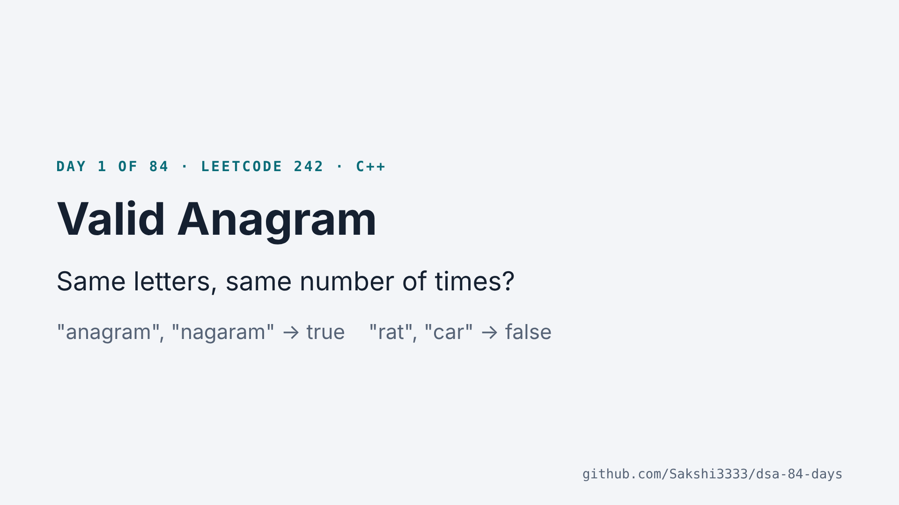
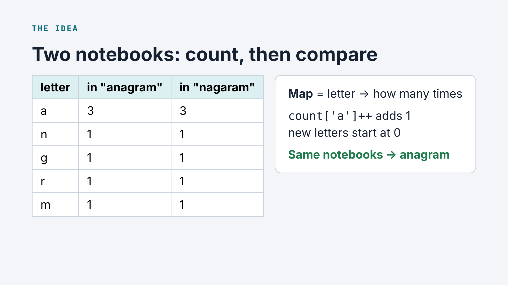
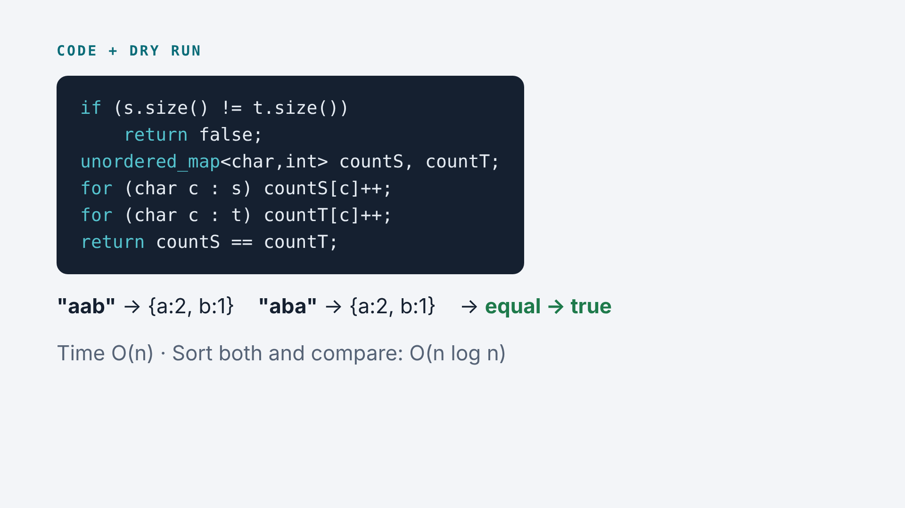
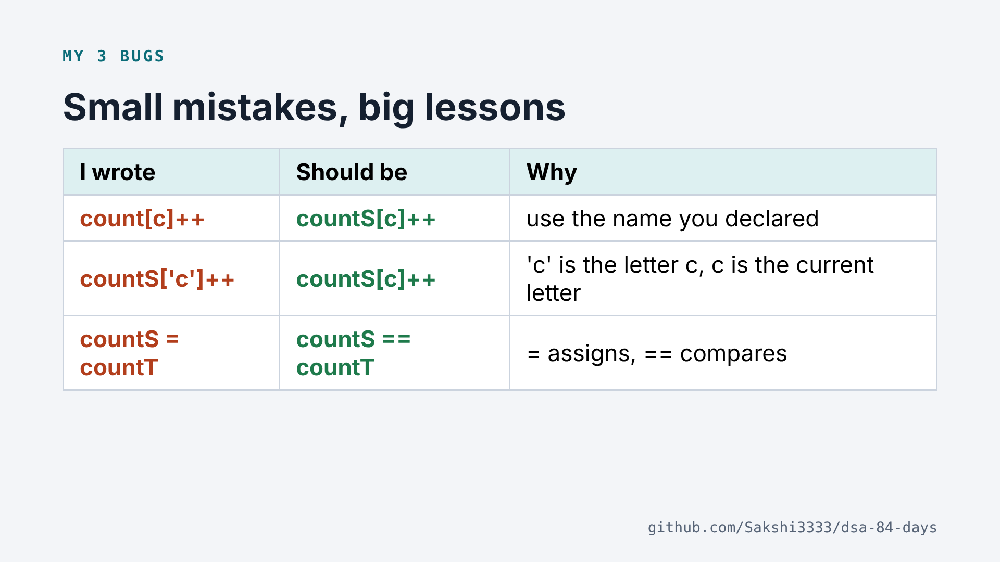

# Valid Anagram

[LeetCode 242](https://leetcode.com/problems/valid-anagram/) · Easy · Pattern: **counting with a map** · Solved 25 Oct 2026

Return `true` if `t` uses exactly the same letters as `s`, the same number of times.
`"anagram", "nagaram"` → `true` · `"rat", "car"` → `false`

## My journey

| Step | What happened | Lesson |
|---|---|---|
| Pen idea | "Count each letter in both words; if every letter appears the same number of times, it's valid." | This was already the real solution. |
| Bug 1 | Wrote `count[...]` but my maps were called `countS` and `countT` | Use the exact variable names you declared. |
| Bug 2 | Wrote `['c']` (the letter c) instead of `[c]` (the current letter) | Quotes = a fixed character. No quotes = the variable. With `'c'`, "anagram" became `{c: 7}`. |
| Bug 3 | Wrote `countS = countT` | One `=` assigns, two `==` compare. |
| Result | **Accepted** | |

## The idea as a story

**Two notebooks.** Write down how many times each letter appears in `s` (notebook 1) and in `t` (notebook 2). If the two notebooks are the same, it's an anagram.

A map stores *letter → how many times*. `countS[c]++` adds 1 for letter `c`; a new letter starts at 0 automatically.

## Code, line by line

| Line | In plain words |
|---|---|
| `if (s.size() != t.size()) return false;` | Different lengths can never have the same letters. |
| `unordered_map<char,int> countS, countT;` | Two empty notebooks. |
| `for (char c : s) countS[c]++;` | Count every letter of s. |
| `for (char c : t) countT[c]++;` | Count every letter of t. |
| `return countS == countT;` | Same notebooks → anagram. |

**Dry run** with `"aab"`, `"aba"`: countS = {a:2, b:1}, countT = {a:2, b:1} → equal → `true`.

## Complexity

| Approach | Time | Extra space |
|---|---|---|
| Sort both words, compare | O(n log n) | O(1)* |
| **Two maps (mine)** | **O(n)** | O(1), at most 26 keys each |
| One array of 26 (+1 for s, −1 for t) | O(n) | O(1), fastest in practice |

*apart from what the sort uses

## Interview follow-up

**Q:** What if the strings contain Unicode characters (Hindi, emoji)?
**A:** The 26-box array no longer works, because there are far more than 26 characters. The map version still works, because a map can hold any key. That's a good reason to know both.

## Slides (quick revision)

## Teaching script

1. **Problem:** same letters, same number of times? anagram/nagaram → true, rat/car → false.
2. **Pen idea:** count each letter in both words and compare the counts.
3. **Tool:** a map, letter → count. `count['a']++` adds 1; new letters start at 0.
4. **Code:** lengths differ → false · two notebooks · count s · count t · `return countS == countT`.
5. **Dry run:** aab / aba → {a:2, b:1} both → true.
6. **My bugs:** `count` vs `countS`, `'c'` vs `c`, `=` vs `==`.
7. **Complexity:** O(n) time. Sorting is O(n log n).
8. **Remember:** to compare how many times things appear, count them with a map.

## Video

_Link coming soon_
